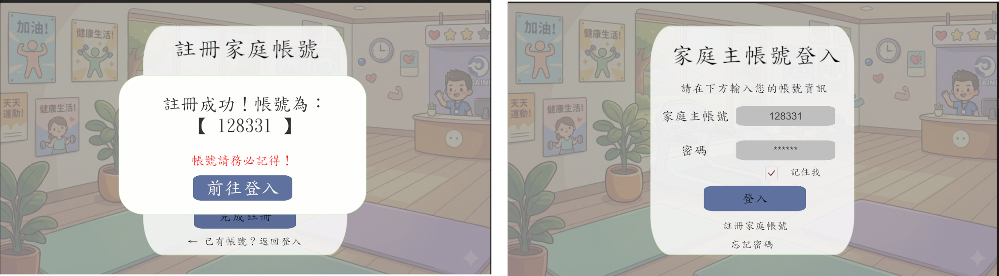
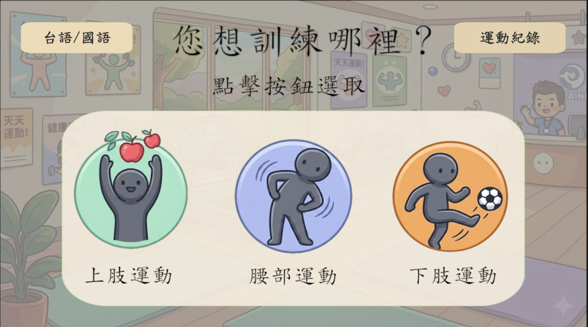
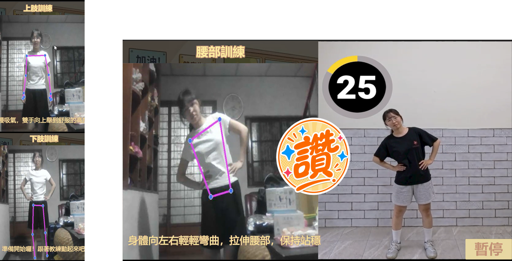
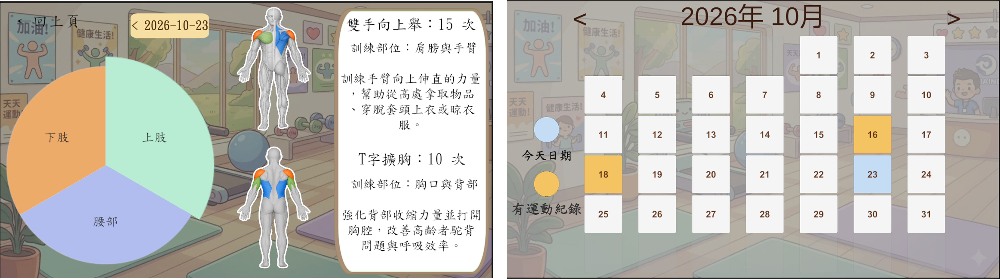
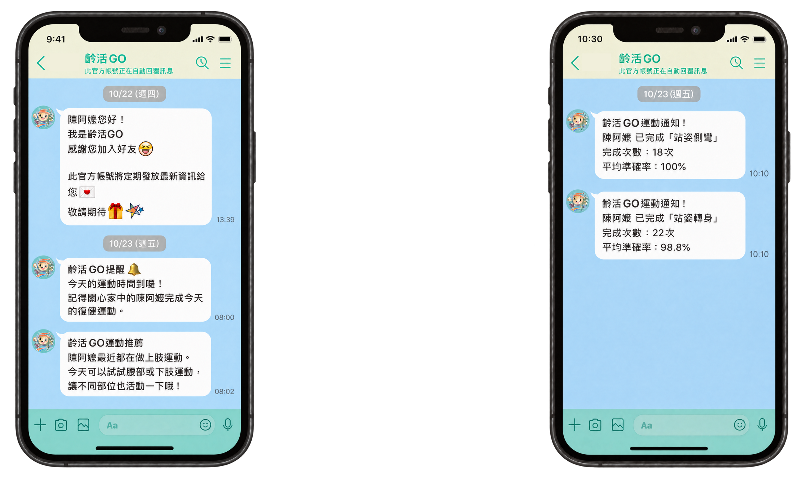

# 齡活 GO｜高齡者居家復健互動系統

本專案結合 **MediaPipe Pose 姿態辨識** 與 **Unity**，專為高齡長輩打造一套免穿戴、直覺易用的居家體感復健輔助系統。長輩在家面對一般視訊鏡頭，即可跟隨虛擬教練進行復健，系統透過 UDP 即時比對關節角度並提供雙語回饋，同時自動記錄長期數據並支援 LINE 關懷排程推播。

---

## 核心功能與系統特色

* **免穿戴式 AI 姿態辨識**：透過 MediaPipe Pose 擷取上肢、腰部與下肢共 6 項基礎動作之關節座標，即時運算角度；達標門檻設為 80% 始予計次，並具備三階段（加油、很好、讚）視覺回饋。
* **低延遲跨進程通訊**：採用 UDP 通訊協定，將 Python 端的局部骨架與運算數據毫秒級同步至 Unity 前端，確保跟練畫面流暢無延遲。
* **高齡友善互動設計**：系統自動配發 6 碼數字主帳號，支援大頭貼一鍵切換多成員；介面採用大按鈕並內建「國語 / 台語」雙語音切換。
* **自動數據收集與報表**：每次訓練數據透過 Flask API 自動寫入 MySQL 資料庫，並於前端轉化為視覺化方塊月曆、動態圓餅圖與日常健康效益說明。
* **LINE 關懷推播與自動排程**：串接 LINE Login 與 Messaging API，結合 Windows 工作排程器與腳本，定時發送個人化運動提醒與訓練成績單至家屬手機。

---

## 系統架構 (System Architecture)

* **前端互動**：Unity（介面操作、動作示範動畫、國/台雙語語音引導）
* **AI 姿態推論**：Python + OpenCV + MediaPipe Pose（骨架座標擷取、關節角度運算）
* **傳輸層通訊**：UDP Protocol（Python 推論端至 Unity 前端即時傳輸）
* **後端中介 API**：Flask API（負責跨模組資料封裝與資料庫寫入）
* **資料庫管理**：MySQL（儲存帳號憑證、動作庫參數與歷史復健紀錄，落實關聯式資料庫 3NF 正規化）
* **推播服務**：LINE Messaging API + Windows Task Scheduler

---

## 個人負責項目與貢獻 (My Contributions)

* **前端互動開發 (Unity)**：建置高齡友善介面、串接 UDP 骨架數據回饋、實作局部骨架運算與雙語語音提示。
* **系統分析與規格設計**：
  * 繪製完整 UML 圖表（包含系統使用個案圖、活動圖、UI/AC 循序圖與類別圖）。
  * 規劃家庭帳號、動作庫與復健紀錄模組，梳理前台與後端 API 數據對接時序。
* **關聯式資料庫正規化**：推導資料庫 1NF 至 3NF 正規化架構，消除資料冗餘並建立資料字典。

---

## 專案成果展示

### 1. 家庭主帳號註冊與登入
系統自動配發 6 碼數字家庭主帳號，簡化憑證設定，方便家庭代表快速建立並登入管理帳號。

  

---

### 2. 家庭成員管理與角色切換
單一主帳號支援多位家庭成員建檔，長輩透過大頭貼即可直覺切換個人檔案，免除記憶複雜密碼的負擔。

  

---

### 3. 高齡友善部位選擇與雙語支援
提供清晰的卡片式部位選擇（上肢 / 腰部 / 下肢），並支援「國語 / 台語」語音一鍵切換，貼合高齡長者的使用習慣。

  

---

### 4. 互動式體感跟練與即時姿態校正
透過視訊鏡頭與 MediaPipe Pose 運算骨架關節角度，提供真人教練示範、即時骨架回饋、倒數計次與三階段貼圖激勵機制。

  

---

### 5. 個人化健康數據與視覺化報表
訓練完成後自動將數據存入資料庫，轉化為直觀的訓練部位圓餅圖、肌群效益說明與方塊月曆視圖，方便追蹤長期成效。

  

---

### 6. LINE 官方帳號推播與家屬關懷
串接 LINE Messaging API 與自動排程，運動達標時即時推播成績單至家屬手機，並定期發送運動提醒與部位推薦。

  

